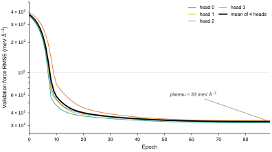
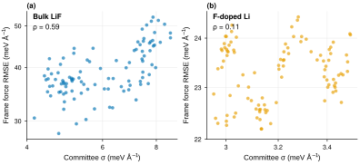
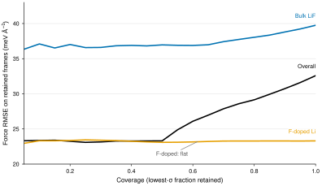

# MHC-4D on the two-environment Li–F candidate

**Run:** `mhc4d_a40_001`, NVIDIA A40, 2026-11-06 18:49 UTC → 2026-11-07 ~01:40 UTC.
**Code:** `b7ac48b` (`orx/four-head-disjoint-frozen-body-mhc`).
**Data:** `jorgemunozl/li-f-uq-interim-two-environments`, revision
`c2699e8e52889c18f6d29f657eb996ac3f78524f` (1,000 train / 200 validation /
200 calibration / 200 test; 500 bulk LiF + 500 F-doped Li).
**Model:** `jorgemunozl/mace_omat_medium`, revision
`d64b6faf564bd682ba1e9ca337408f6925aa908d`.
**Status:** completed; smoke gate passed (84.0% mean validation drop, 77.7%
worst head); 90/90 full epochs.

> **Scope.** This is a development result on a dataset whose F-doped burn-in and
> temporal dependence are unresolved. No newly trained committee or frozen
> probe was evaluated on these frames, so the pre-registered H1/H4 comparisons
> cannot be evaluated from this run alone.

## What ran

A frozen MACE-OMAT-medium body with four randomly initialised readout heads,
trained on a disjoint, environment-stratified split (250 frames/head: 125 bulk
+ 125 F-doped). Force-only loss (`energy_weight=0`), batch 16, learning rate
`1e-3`, 90 epochs. The run also evaluated the archived pilot MHC and the
zero-shot foundation model on the same calibration and test frames.

This tests the paper's construction, not its numerical setup: 4 heads instead
of 8, 250 instead of 1,000 frames/head, ~5,600 instead of 800,000 updates,
force-only instead of energy+force, and a different foundation checkpoint.

## Accuracy

| Method | Overall | Bulk LiF | F-doped Li |
|---|---:|---:|---:|
| **MHC-4D, this run** | **33.25** | **39.75** | **23.30** |
| Archived pilot, same frames | 58.69 | 74.79 | 29.95 |
| Zero-shot foundation | 48.20 | 59.27 | 30.23 |

Force RMSE in meV/Å on the 200-frame test split. The archived pilot was trained
on the older 214-frame split; its same-frame evaluation is descriptive, not a
controlled baseline. The old committee's 8.66 meV/Å was measured on a different
split and is not a like-for-like comparison.



On validation, the four heads fall from ~382 meV/Å at initialisation to ~33 meV/Å by epoch 20
and then plateau; the last 40 epochs move by less than 1 meV/Å. More epochs
would not close the gap to committee accuracy. The plateau is the frozen-body,
force-only, 250-frame/head result, not an optimisation failure.

| Head | Test force RMSE (meV/Å) |
|---|---:|
| 0 | 33.43 |
| 1 | 34.49 |
| 2 | **32.72** |
| 3 | 33.89 |
| Ensemble | 33.25 |

The ensemble is slightly **worse** than its best member (32.72), so there is no
committee variance reduction — expected when all heads share the same frozen
body and differ only in readout initialisation and data slice.

## Ranking

| Scope | Spearman ρ | Pearson r | n frames |
|---|---:|---:|---:|
| Overall | 0.837 | 0.911 | 200 |
| Bulk LiF | 0.589 | 0.645 | 100 |
| F-doped Li | **0.106** | 0.156 | 100 |

The overall 0.84 is largely a **between-environment** effect: bulk frames have
both larger σ and larger error than F-doped frames, so pooling them creates a
strong rank correlation that is absent within F-doped Li.

The archived pilot shows the same trap from the other side: its pooled
ρ = 0.365, but its within-group ρ is negative (bulk −0.87, F-doped −0.69).
Pooled correlations are not comparable across methods with different
between-group error contrasts.



The F-doped panel makes the mechanism explicit: σ spans only 2.95–3.50 meV/Å
while the frame error spans 22.2–24.4 meV/Å. There is almost no uncertainty
variation to rank. In bulk, σ spans 4.16–8.63 meV/Å and the ranking is
moderate.



The overall risk–coverage curve improves from 33.25 to 23.36 meV/Å at 10%
coverage (−30%), but this is mostly **environment selection**: the lowest-σ
frames are predominantly F-doped, whose full RMSE is already 23.30. Within
groups, bulk improves only from 39.75 to 37.09 (−7%), and F-doped is flat
(23.32 vs 23.30). The overall curve therefore cannot be read as successful
within-environment ranking.

## Calibration

| Metric | Overall | Bulk LiF | F-doped Li |
|---|---:|---:|---:|
| `α_force` | 12.84 | — | — |
| 1σ coverage | 0.782 | 0.826 | 0.730 |
| 2σ coverage | 0.937 | 0.961 | 0.909 |
| RLL | **−0.394** | −0.263 | −0.571 |

`α = 12.84` means the raw committee spread is about 13× too small; after global
scaling, 1σ coverage is 0.78 (nominal 0.68) and 2σ coverage is 0.94 (nominal
0.95). Coverage alone looks acceptable, but RLL is **negative in both groups**:
the calibrated predictive distribution is worse than a constant Gaussian with
σ equal to the calibration RMSE (0.0332 eV/Å). The σ ordering is not reliable
enough for a likelihood-based calibration claim.

Energy metrics are not interpretable: the run used a force-only objective and
the QE isolated-atom energies differ from the foundation E0 reference.

## Interpretation

- **Accuracy:** the repaired four-head disjoint recipe is a clear improvement
  over the failed warm-start pilot and over zero-shot on these frames, but it
  plateaus at ~33 meV/Å, roughly 3.8× the archived committee's 8.66 meV/Å on its
  own split. The frozen-body, 250-frame/head, force-only configuration is not
  committee-grade.
- **Ranking:** the pooled ρ = 0.84 is misleading. Only bulk LiF carries useful
  within-group signal (ρ = 0.59); F-doped Li has essentially none (ρ = 0.11)
  because its σ range is tiny.
- **Calibration:** global α fixes the average scale but not the ordering; RLL
  is negative in both groups. Coverage should not be reported without RLL (or
  a comparable proper score).
- **Committee gain:** the ensemble is slightly worse than its best member, so
  the four heads behave as four correlated readouts, not as an ensemble that
  reduces error.

These are results for **this configuration**, not a verdict on MHC. The design's
pre-registered escalation is a 4-head, 80%-overlapping run (800 frames/head,
3.2× the per-epoch cost) to test whether per-head data, rather than head count,
is the binding constraint. A matched 3-member committee and frozen probe on
these exact frames are still needed before any H1/H4 claim.

## Artifacts

- `figures/training-curves.{svg,pdf}` — validation force RMSE per head.
- `figures/uncertainty-vs-error.{svg,pdf}` — per-frame σ vs error by environment.
- `figures/risk-coverage.{svg,pdf}` — RMSE of the lowest-σ fraction.
- `data/metrics.csv` — tidy metrics for all three methods and scopes.
- `data/training_curves.csv` — epoch/head validation RMSE.
- `data/risk_coverage.csv` — risk–coverage points.
- `make_analysis.py` — regenerates every table and figure from the archived run.
- `../full/evaluation/uq_summary.json` — runner's machine-readable metrics.
- `../run.log` — complete setup, smoke, training and evaluation log.

Reproduce:

```bash
cd analysis
uv run --no-project --with matplotlib --with numpy python make_analysis.py
```
